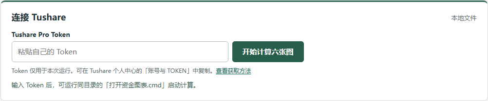

# 国家队资金捕捉 · 宽基 ETF 资金监控

这是一款在 Windows 本机运行的 A 股研究看板，用六张图观察宽基 ETF 净申赎、指数位置、沪深融资余额，以及沪深300股息率与十年期国债收益率的关系。ETF 份额变化可以用来估算资金流向；公开数据无法识别具体申购或赎回机构。

**[下载 Windows 版 ZIP](https://github.com/zhangchiep/china-etf-flow-monitor/releases/latest/download/china-etf-flow-monitor-windows.zip)** · [查看发布版本](https://github.com/zhangchiep/china-etf-flow-monitor/releases)

## 第一次使用

1. **下载并完整解压。** 将 ZIP 解压到自己有写入权限的文件夹，例如「文档」。也可以用 GitHub 仓库的 **Code → Download ZIP** 下载源码。
2. **打开解压后的文件夹，双击 `打开资金图表.cmd`。** 如果 Windows 隐藏了扩展名，双击名称为「打开资金图表」的文件即可。等待启动器准备好环境，浏览器会自动打开同一文件夹里的 **`打开图表.html`**。Windows x64 电脑没有可用 Python 时，会自动下载约 31 MB 的官方 Python 运行环境，再安装计算依赖。首次准备需要联网。
3. **在 `打开图表.html` 页面填写 Token。** 登录 Tushare，在「个人中心 → 账号与 TOKEN」复制自己的 Token。回到刚打开的看板，在「连接 Tushare」区域找到 **Tushare Pro Token** 输入框，粘贴后点击 **「开始计算六张图」**。[Tushare 获取 Token 说明](https://tushare.pro/document/1?doc_id=39)
4. **等页面显示六张图。** 第一次会下载多年历史，耗时随网络和账号限频而变。命令窗口在环境准备完成后自动关闭，网页会继续显示计算进度。

如果先双击了 `打开图表.html`，也可以先填 Token、点计算。保持该页面打开，再按提示双击同文件夹的 `打开资金图表.cmd`，计算会自动接续，只需输入一次。

## 六张图能看什么

| 图 | 研究问题 | 图中指标 |
|---|---|---|
| ① 宽基指数价格位置 | 哪些指数接近近期高点？ | 比较 11 个宽基指数的收盘价分位和距最高收盘价的幅度。默认回看 250 个交易日，也可改用所选区间。 |
| ② 固定样本分组净申赎 | 哪一组宽基 ETF 净申购较多？ | 首次建库时锁定十组样本。每组取其最近一个成员数据齐全的交易日，组间比较时可查看各组日期。 |
| ③ 全市场可识别宽基 ETF 净申赎 | 每天有多少资金净申购或净赎回？一段时间累计多少？ | 红柱表示净申购，绿柱表示净赎回，均读左轴；橙线表示累计额，读右轴。支持切换累计起点及覆盖口径。 |
| ④ 三只沪深300 ETF 份额与指数 | 代表性 ETF 的总份额和指数怎样变化？ | 对照 510300、510310、510330 三只基金的同日合计份额（亿份）和沪深300收盘点位。 |
| ⑤ 沪深融资余额 | 两个市场的融资余额怎样变化？ | 分别展示沪市、深市余额（亿元），并标明各自实际披露日期。 |
| ⑥ 沪深300股息率与十年期国债 | 股票股息率和国债收益率相差多少？ | 用过去 12 个月沪深300税前现金股息点除以当日沪深300收盘点位，得到滚动股息率。与财政部十年期国债收益率同日相减，得到利差（百分点）。 |

### 怎样读图③

每只 ETF 的日净申赎估算（亿元）＝ **（当日份额 − 前一交易日份额）× 当日未复权收盘价 ÷ 10,000**，其中份额单位为万份。程序按日识别符合条件的基金，排查折算等异常，再把可计算的金额相加。

看累计曲线时，先选 **累计起点**。选「所选开始日」可看这个区间新增了多少，选「可用申赎历史起点」可看截至所选结束日的长期累计。再看 **覆盖数量**，例如“95/100”表示当天识别出 100 只，其中 95 只可以计入金额。「已覆盖金额」会累加当日有数据的部分；「仅完整口径」遇到缺口时，严格累计从该日起留空。早期基金目录、份额和行情的覆盖程度会影响结果。

## 分图选择观察时间

六张图默认使用顶部的统一观察区间。**图③至⑥可以各看各的时间段**，方便在同一个页面对照短期资金变化与长期趋势。

1. **手动选区间**　在目标图里输入开始、结束日期，或点击日历选择。选好后该图自动重算，日期下方会显示「本图独立区间」。
2. **按本图结束日回看**　先选好这张图的结束日期，再点「近1年」「近3年」或「全部历史」。按钮只改开始日。「全部历史」从这张图的可用历史起点开始，一直看到你选的结束日。
3. **恢复联动**　调整顶部区间时，已经独立设置的图会保留原日期。点击某张图的「跟随顶部」，它就恢复使用顶部的开始和结束日期，其他图的设置照常生效。

例如，想把 **2025 年全年的宽基 ETF 申赎**和**截至 2026 年 11 月的三年股债利差**放在一起看，可以这样选：

| 图表 | 在该图里选择 | 得到的观察区间 |
|---|---|---|
| 图③ 宽基 ETF 净申赎 | 结束日选 2025-12-31，点「近1年」 | 2025-01-01 至 2025-12-31 |
| 图⑥ 股息率与国债收益率 | 结束日选 2026-11-20，点「近3年」 | 2023-11-21 至 2026-11-20 |

若要读出示例中 **2025 年内**的累计净申赎额，图③的「累计起点」选「所选开始日」。这样橙线从本次观察窗口开始累计。

## 日常更新和离线查看

- **更新数据**　双击 `打开资金图表.cmd`，新会话在网页中输入 Token。已有历史会复用，程序续接新数据并复查近期观测。各图按上游实际披露日期更新。
- **离线查看**　建库后双击 `打开图表.html` 就能看已有历史、切换日期和查看明细。保留同目录的 `程序` 和 `数据` 文件夹。

## 数据、权限与隐私

| 数据来源 | 用途 | 使用者需要准备什么 |
|---|---|---|
| Tushare Pro | 图①至⑤的行情、份额、目录与融资数据，以及图⑥的沪深300股息点和价格指数 | 本人 Token 和相应接口权限。图②、③需要 ETF 日线 `fund_daily`，官方目前要求至少 **5000 积分**；频次以本人账号为准。[ETF 日线](https://tushare.pro/document/2?doc_id=127) · [基金份额](https://tushare.pro/document/2?doc_id=207) |
| 财政部中国国债收益率曲线 | 图⑥的十年期国债收益率 | 程序自动读取，免登录。[官方历史曲线](https://yield.chinabond.com.cn/cbweb-czb-web/czb/showHistory?locale=cn_ZH&nameType=1) |
| 上交所披露的基金公告 | 核实部分 ETF 的申赎开放、暂停与清算日期 | 已核实的日期、公告标题及出处随源码提供，日常使用无需手填。[项目公告索引](程序/etf_disclosures.json) |

Token 仅在本次本机服务运行期间保存在内存中，用于向 Tushare 请求数据。下载包只含源码、说明和公告索引。每位使用者在自己的电脑生成 `数据` 文件夹；分享项目时请使用原始发布包。

## 许可

项目自有源码采用 [MIT 许可证](LICENSE)。Apache ECharts 和其他第三方组件保留各自的许可证与声明。[第三方许可文件](程序/vendor/) 数据使用及再分发遵循各提供方条款。[Tushare 数据服务协议](https://tushare.pro/document/1?doc_id=405) · [中证沪深300股息点指数编制方案](https://oss-ch.csindex.com.cn/static/html/csindex/public/uploads/indices/detail/files/zh_CN/H30401_Index_Methodology_cn.pdf)
